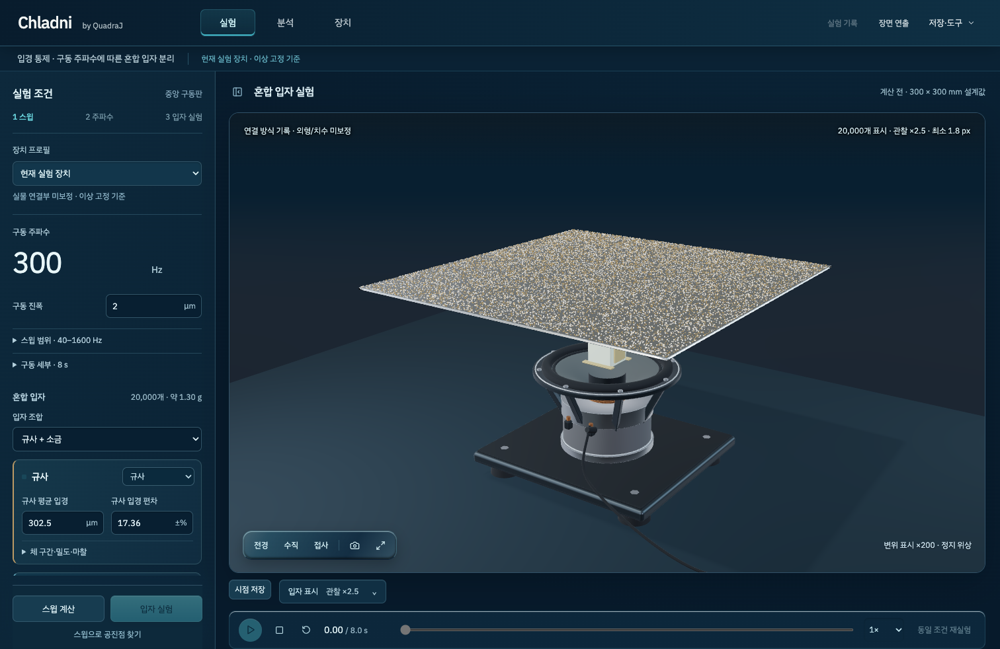

# Chladni

입경과 구동 주파수에 따른 혼합 입자 이동을 계산하고 실측 자료와 비교하는 가상실험실. 제작: QuadraJ.

**[가상실험실 열기](https://pastelj321.github.io/Chladni/)** · [검증 기록](docs/VALIDATION.md) · [계산 모델](docs/CONNECTOR-MODEL.md)



학교 과학과제연구 **「입경 통제 및 구동 주파수에 따른 직접·역 클라드니 혼합 입자 분리」**를 위한 웹 기반 연구 도구다. FEM 계산, 입자 운동 근사, 사용자 관측을 구분해 같은 실험 세션에서 관찰한다.

```sh
npm ci
npm run dev
```

Node.js 22.12 이상 · WebGL 2 필요. 개발 서버 주소는 실행 로그에 표시된다. 공개 기준 브랜치는 `main`이며, 기존 개발 이력은 `codex/chladni-v0.2`에 보존한다.

## 사용 흐름

1. **실험**에서 장치 프로필과 두 입자군의 종류·입경·혼합 비율을 선택한다. 실제 장치의 치수와 물성은 **장치 → 장치 기록**에서 출처·불확도와 함께 입력한다.
2. **스윕 계산** → 공진 후보 선택 → **입자 실험**. 주파수와 입자 조건만 바꾸면 판 고유모드를 재사용한다.
3. 하단 시간 막대에서 계산 결과를 재생·정지·되감기한다. **입자 표시**의 실제 크기/관찰용 확대는 물리 입경을 바꾸지 않는다.
4. **분석**에서 모드·진폭·마디선·궤적, 입자군별 밀도와 마디/배 주변 비율, 지정 영역 순도·회수율을 비교한다. 실측 사진·영상을 불러와 네 모서리를 지정하고 원근 보정·시간 정렬·수동 영역 관측을 수행한다.
5. **장치**에서 구조·분해·조립·단면·투시를 관찰한다. 실측 CAD는 출처와 부품 매핑을 명시해 GLB/내장형 GLTF로 불러온다. 가져온 외형은 구조 참조이며 자동 FEM 메시로 변환되지 않는다.
6. **실험 기록**으로 조건·결과·관측 메모를 남기고 **저장·도구**에서 세션·JSON·CSV·PNG를 내보낸다. **이 기기에 보관**한 세션은 오프라인 준비가 완료된 브라우저에서 다시 열 수 있다. 발표 화면은 저장 결과 재생과 새 계산을 구분한다.

## 장치와 계산의 출처

현재 장치는 판 관통 구멍 없이 임시 접착 연결부를 사용하는 것으로 기록되어 있다. 치수·강성·스피커 응답·사진/CAD는 제공되지 않았다. 기본 300×300×2 mm 판과 절차적 외형은 설계 프리셋이다. 현재 장치·연결부 보강안·이상 장치를 별도로 보존하며, 자료가 없는 항목은 미입력으로 남긴다. 100 Hz 설탕 패턴은 재현되지 않은 사용자 관찰 기록이며 계산 기준값으로 사용하지 않는다.

- **판 FEM**: 등방성 Kirchhoff–Love C¹ BFS 직사각 요소, 24개 질량 정규화 모드. 치수·재료·경계·구동 위치와 감쇠를 반영한다.
- **연결부**: 선택한 접촉 영역의 평균 변위·회전에 등가 스프링/댐퍼/질량을 연결한다. 입력된 강성과 질량만 계산하며 외형에서 임의 물성을 유도하지 않는다. 강성 보정은 사용자 모드 대응과 출처가 있는 관측값을 사용하고 독립 검증 데이터를 분리한다. [연결부 모델](docs/CONNECTOR-MODEL.md)
- **입자**: 기존 주기 평균 드리프트 또는 별도의 독립 구형 접촉·충돌·구름 근사. 접촉 모델은 계산 예산을 검사하며 입자 수를 자동으로 줄이지 않는다. 정지 공기 Stokes 항력은 선택 사항이다. 두 모델 모두 비보정 근사이고 입자 간 DEM·응집·공기 유동·실제 역패턴/분리 효율을 예측하지 않는다. [접촉 모델](docs/CONTACT-MODEL.md)
- **스윕**: 33개 준정상 복소 FEM 응답을 보간한다. 빠른 주파수 변화의 판 과도응답과 좁은 공진의 적응 탐색은 포함하지 않는다.
- **물성**: 프리셋 밀도는 대표값, 마찰·반발·형상은 비보정 가정이다. 녹차분말은 입경과 입자 밀도를 입력해야 계산할 수 있다. 혼합 비율은 개수/질량 기준을 구분하며 질량은 구형 등가 근사다.

## 표시와 저장

기본 20,000개, 최대 50,000개를 드리프트 모델로 직접 적분한다. 최대 100,000개 표시는 추가 대표 시각 표본을 포함하며 이 표본은 질량·분석 통계에 포함하지 않는다. 원경은 GPU 스플랫, 접사는 군별 최대 4,096개 PBR 메시와 나머지 스플랫을 결합한다. 관찰용 기본 지름 2.5배·최소 1.8 CSS px는 실제 입경과 독립이다.

보통 20 Hz Float32 체크포인트를 연속 보간한다. 긴 결과는 약 96 MiB 기록 예산에 맞춰 저장 간격을 늘린다. `chladni/5` 세션은 조건·계산·프로필·불확도·수동 관측·보정 근거·카메라 시점을 저장하며 `/2`, `/3`, `/4` 기록도 읽는다. 작은 사진은 내장하고 영상·큰 원본·CAD는 파일 정보로 재연결한다. 원본을 삭제하면 세션만으로 복구할 수 없다. 대용량 내보내기는 현재 주 스레드에서 직렬화한다.

## 공개와 배포

GitHub Pages는 `gh-pages` 루트의 정적 빌드 결과를 제공한다. 계산은 브라우저에서 실행하며 별도 계산 서버나 계정 로그인을 요구하지 않는다. 업로드한 사진·영상은 앱이 서버로 전송하지 않는다. 첫 접속은 온라인이어야 하며, **오프라인 준비됨** 표시 후 기기에 보관한 세션을 다시 열 수 있다. 브라우저 저장소를 삭제하면 기기 보관본도 삭제되므로 연구 기록은 파일로 내보내는 것이 좋다.

`main`의 변경사항을 커밋·푸시한 뒤 다음 명령으로 다시 게시한다. 사용자 정의 Actions 빌드 없이 로컬에서 빌드한다.

```sh
git switch main
npm ci
npm run deploy:pages
```

배포 스크립트는 작업 트리가 깨끗하고 로컬 `main`이 원격과 같을 때만 실행한다. 기존 저장소에서 임시 Git 인덱스로 빌드 트리를 만들며 별도 복제 저장소를 만들지 않는다. 빌드 결과의 `deployment.json`에서 원본 커밋을 확인할 수 있다. GitHub Pages의 게시 소스는 `gh-pages` 브랜치의 `/`이다.

## 개발 및 검증

```sh
npm test
npm run build
npx playwright install chromium
CHLADNI_TEST_PRODUCTION=1 npm run test:browser
# production preview 실행 후 60초 반복 재생
npm run test:stability
# Firefox 런타임 설치 후 호환성 검사
npx playwright install firefox
npm run test:firefox
# 개발 서버 실행 후 실제 GPU 측정
npm run benchmark
```

2026-11-24 통합 검증: 단위·상태 테스트 70개, Chromium 브라우저 흐름 11개 통과. Firefox 호환성·60초 반복 재생도 확인했다. M5/Metal의 2만 입자 전체 앱 측정은 실험 58.3fps·분석 60.0fps이며 다른 장치의 성능을 보장하지 않는다. Safari·실기 모바일은 미검증이다.

- [구조와 디자인](docs/DESIGN.md)
- [검증·화면·성능 기록](docs/VALIDATION.md)
- [이전 v0.4 감사](docs/OVERHAUL-v04.md)

실측 보정이 완료된 디지털 트윈으로 표시하지 않는다. 스피커 전달함수, 접착부 이탈·불안정한 기울어짐, 입자 간 충돌과 공기 흐름은 아직 계산 범위 밖이다.
